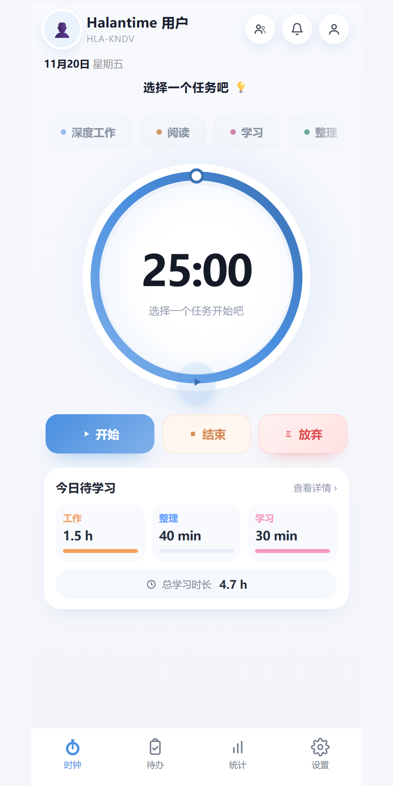
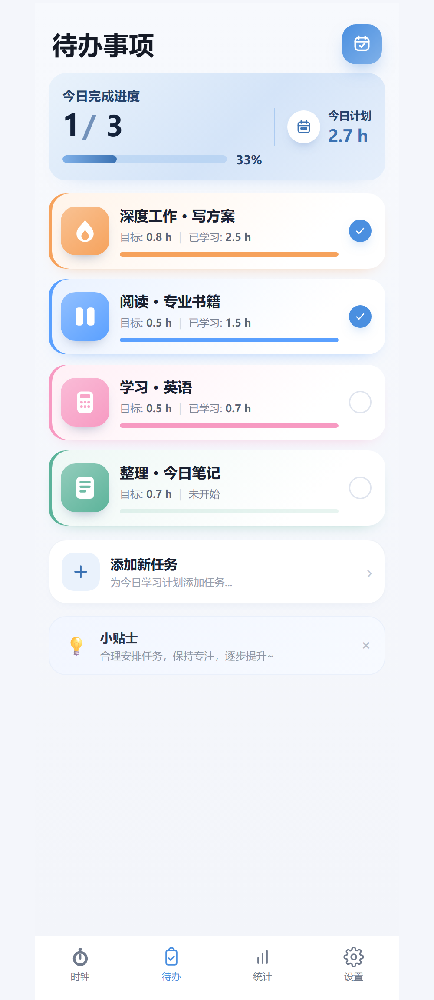
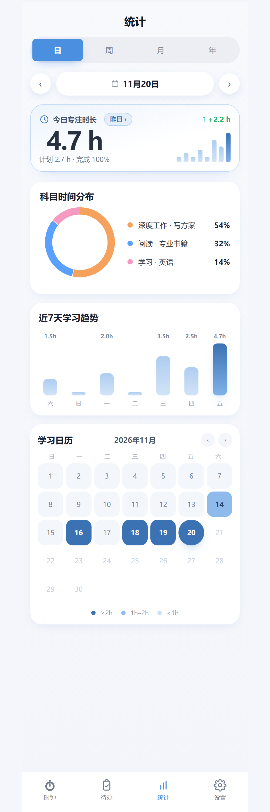
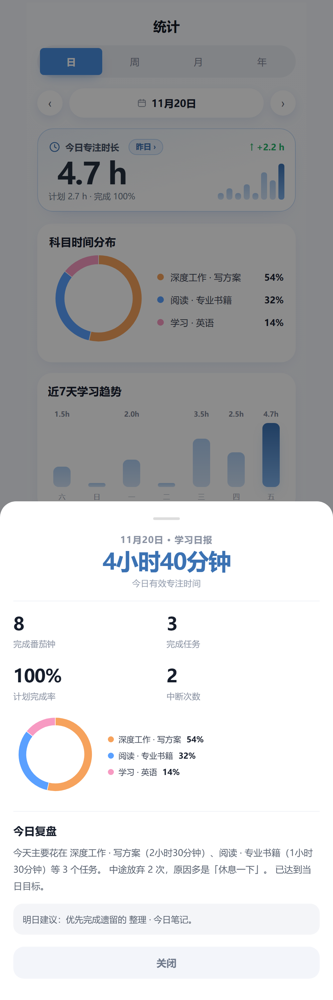

# halan 的自制番茄钟 · Halantime

一个完全本地运行的 Android 番茄钟。整个 UI 是一个 HTML 单文件，用 WebView 套壳打包成 APK —— 没有服务器、没有账号、不联网，所有数据存在手机本地。

> 目前版本 **1.6.4**（versionCode 38），安装包见 [`release/Halantime-1.6.4.apk`](release/Halantime-1.6.4.apk)。

<p align="center">
  
  
  
  
</p>

## 功能

**时钟**
- 倒计时 / 正计时双模式，圆环进度：倒计时从满圈起逆时针吃掉，正计时按小时一圈顺时针
- 环上圆形暂停钮，下方「暂停 | 结束 | 放弃」三按钮
- 半齿轮拖拽调时长，三档字号，全程键鼠/触屏都跟手
- 专注态自动收起任务胶囊，只留一句鼓励标语（带 ✨）

**待办**
- 卡片化任务列表，左侧彩色图标（8 种图形 × 6 组配色，可自选）
- 右上角「每日复习计划」：勾选任务 + 每个任务每天做几遍（1–5），自动算出今日目标
- 进度卡显示 `2 / 3` 与「今日计划 2.7 h」，与时钟页、统计页目标三处联动
- 长按任务可编辑，删除有二次确认

**统计**
- 日 / 周 / 月 / 年四种视图，今日专注时长卡带环比、近 8 天迷你柱
- 科目时间分布环形图（图例按占比排序）
- 近 7 天柱状趋势、学习日历（三档热度，以当日目标为阈值）
- **学习日报**：点日历格子或今日卡上的「昨日 ›」按钮弹出 —— 大号时长 + 四项指标（番茄钟 / 完成任务 / 计划完成率 / 中断次数）+ 科目饼图 + 今日复盘 + 明日建议

**其他**
- 14 种白噪音（雨、海浪、壁炉、雷雨、咖啡馆、键盘、火车、风扇……），可叠加混播
- 8 套主题（清爽蓝 / 黑 / 红 / 黄 / 绿 / 紫 + 我的世界、英雄联盟彩蛋皮），全站配色由主题色推导
- 后台计时：时间戳 + 前台服务，锁屏/切后台不丢秒
- 返回键逐层后退（弹层 → 背景音乐 → 页面 → 退出到桌面）
- 放弃专注可选原因（休息一下 / 吃饭 / 感觉自己效率不高 / 其他），放弃时长不计入统计

## 安装

1. 下载 [`release/Halantime-1.6.4.apk`](release/Halantime-1.6.4.apk)
2. 手机上允许「安装未知来源应用」后安装
3. 最低 Android 7.0（minSdk 24），目标 SDK 36

也可以直接把 `app/assets/flowtime.html` 拿到浏览器里打开，网页版功能基本一致（音频依赖同目录的 `audio/` 文件夹）。

## 项目结构

```
app/
  AndroidManifest.xml            清单（vc38 / 1.6.4，minSdk 24 / target 36）
  assets/
    flowtime.html                全部 UI + 逻辑，单文件约 3700 行
    audio/*.mp3                  14 条白噪音
  res/mipmap-*/ic_launcher.png   应用图标（5 个密度）
  src/com/flowtime/app/
    MainActivity.java            WebView 容器 + 返回键分层处理
    FocusService.java            前台服务，保证后台计时不被杀
build/
  assemble.py                    assets + res + dex → unsigned.apk（resources.arsc 需 STORE）
  build_real.py                  白噪音加工：原始录音 → 60 秒无缝循环 mp3
release/
  Halantime-1.6.4.apk            已签名成品
docs/screenshots/                README 用截图
```

## 本地构建

只改 HTML / 图片时不用重新编译 Java，直接复用已有 `classes.dex`：

```bash
export JAVA_HOME=/path/to/jdk17
BT=$ANDROID_HOME/build-tools/36.1.0
AJ=$ANDROID_HOME/platforms/android-36/android.jar

aapt2 compile --dir app/res -o compiled_res.zip
aapt2 link -o base.apk -I $AJ --manifest app/AndroidManifest.xml \
    -R compiled_res.zip --java gen --auto-add-overlay
python build/assemble.py --build-dir .   # 递归收 assets，arsc 必须 ZIP_STORED
zipalign -f 4 unsigned.apk aligned.apk
apksigner sign --ks your.jks --out Halantime.apk aligned.apk
apksigner verify Halantime.apk           # 期望 0
```

改 Java 部分则需要先跑 `javac` + `d8` 生成新的 `classes.dex`，再执行上面的 `assemble.py`（仓库不含预编译产物）。

## 数据与隐私

- 没有网络权限，不采集任何数据；统计全部来自本机 `localStorage`（键：`ft_tasks` / `ft_records` / `ft_settings` / `ft_plan` 等）
- 卸载即清空，不做云同步
- 仓库里**不包含**签名密钥（`*.jks`），自行构建请用自己的密钥

## 素材说明

白噪音来自公有领域 / CC0 录音，做了统一采样率与循环裁剪后打包。

## 版本沿革

| 版本 | 内容 |
| --- | --- |
| 1.4.x | 按设计稿重写三屏：白卡 + 浅蓝渐变 + 胶囊；圆环几何、统计饼图、日历弹层、后台计时 |
| 1.5.x | 复习计划弹层、待学卡、图标自选、专注态收起胶囊、正计时每小时一圈、放弃原因弹窗 |
| 1.6.0 | 主题色全站联动（圆环 / 进度 / 日历 / 柱状），8 套主题统一推导 |
| 1.6.1 | 主题加入红色、应用图标红环改蓝环、浅色主题柱体更清晰 |
| 1.6.2 | 学习日报按参考版式重做，统计卡加「昨日 ›」快捷入口 |
| 1.6.3 | 学习日报中段加入科目时间分布饼图 |
| 1.6.4 | 放弃原因「接电话」→「感觉自己效率不高」 |
